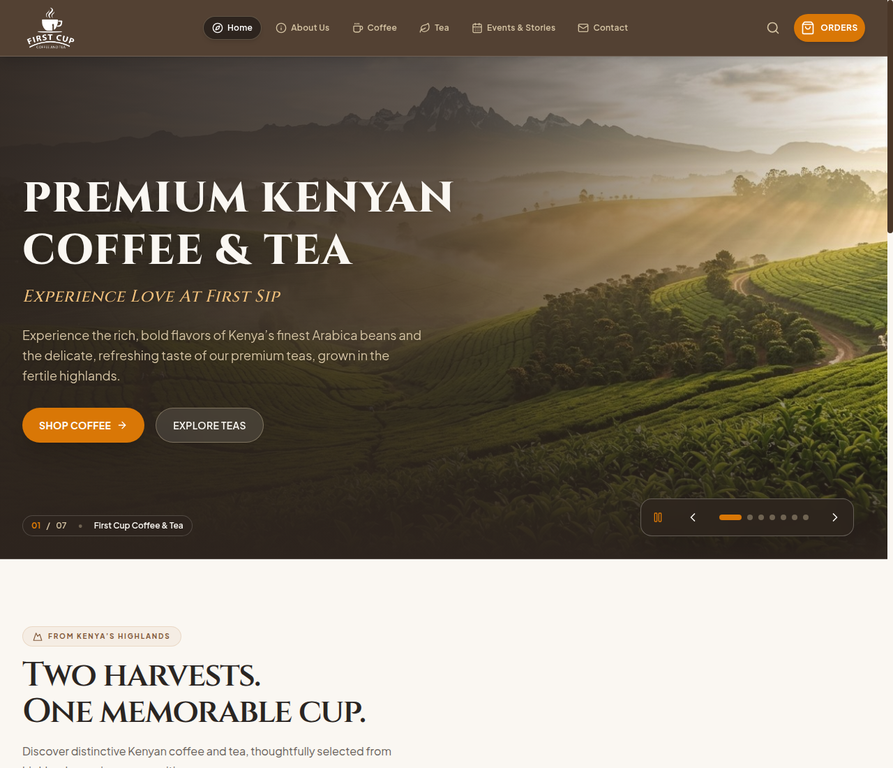
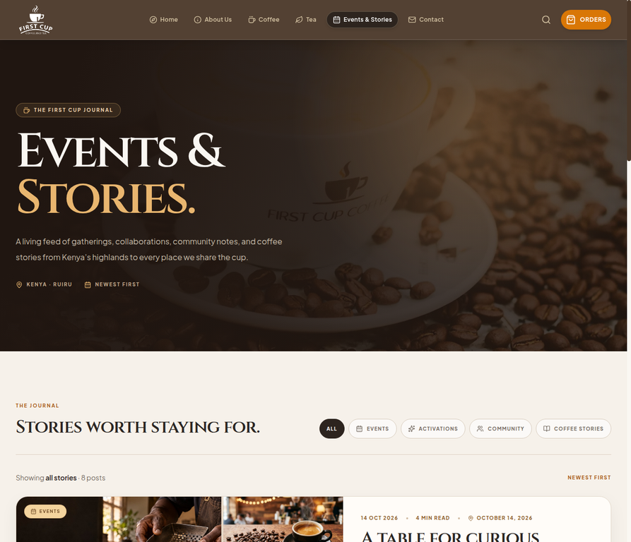

# First Cup Coffee & Tea

First Cup Coffee & Tea is a responsive, editorial-style storefront for a Kenyan coffee and tea brand. The experience combines premium product discovery, origin storytelling, export and supply enquiries, an order-request flow, and a publishing surface for Events & Stories.

## Preview

- **Local development:** `http://localhost:3000`
- **Current sandbox preview:** [Open the live preview](https://3000-i6iwq62jse8as7d7spuhg-817b62f8.us3.manus.computer/)
- **Events & Stories preview:** [Open Events & Stories](https://3000-i6iwq62jse8as7d7spuhg-817b62f8.us3.manus.computer/events-stories)

## Site screenshots

### Home page

The Home page introduces the First Cup brand, hero slideshow, featured coffee and tea collections, origin story, and the First Cup difference section.



### Events & Stories

The Events & Stories page is a unified, filterable publishing feed. Posts remain distinguishable through category tags and styling for Events, Activations, Community, and Coffee Stories.



## Core features

- Premium Kenyan coffee and tea storefront experience
- Responsive Home hero slideshow with image and video slides
- Mobile-safe muted inline hero video playback
- Coffee and tea catalogs with product detail modals
- Coffee roast selection and pack-size selection
- Cart drawer and order-request checkout flow
- WhatsApp, email, export, vending, and supply enquiry paths
- About Us page with company and export information
- Coffee and tea process storytelling sections
- Coffee grades, roast education, tea grades, and tea types
- Events & Stories publishing feed with:
  - Newest-first post ordering
  - Category filtering
  - Reusable post data model
  - Multi-image cards
  - Slideshow gallery when a post is opened
- SEO metadata, sitemap, robots rules, and route manifest
- Optimized WebP page images and lazy-loaded inactive hero slides
- Touch-friendly responsive layouts for mobile, tablet, and desktop

## Tech stack

- React 19
- TypeScript
- Vite
- Tailwind CSS
- Lucide React icons
- ESLint-compatible TypeScript diagnostics through `tsc`

## Getting started

### Requirements

- Node.js 18 or newer
- npm

### Install and run

```bash
npm install
npm run dev
```

Open [http://localhost:3000](http://localhost:3000).

### Useful commands

```bash
# Run TypeScript diagnostics
npm run lint

# Create a production build
npm run build

# Preview the production build, if needed
npm run preview
```

## Content editing

Most content is data-driven. The complete editing map is available in [`EDITING_GUIDE.md`](./EDITING_GUIDE.md).

| Content | File |
| --- | --- |
| Hero slides, hero text, and hero media | [`src/data/companyData.ts`](./src/data/companyData.ts) |
| Home reusable image paths | [`src/data/siteAssets.ts`](./src/data/siteAssets.ts) |
| Coffee product names, descriptions, and images | [`src/data/coffeeData.ts`](./src/data/coffeeData.ts) |
| Tea product names, descriptions, and images | [`src/data/teaData.ts`](./src/data/teaData.ts) |
| Events & Stories posts and galleries | [`src/data/eventsStoriesData.ts`](./src/data/eventsStoriesData.ts) |
| Coffee and tea process steps | [`src/data/companyData.ts`](./src/data/companyData.ts) |
| About Us and export content | [`src/components/AboutSection.tsx`](./src/components/AboutSection.tsx) |
| Global design tokens and styles | [`src/index.css`](./src/index.css) |

### Changing an image

1. Add the replacement asset under `public/` using a descriptive kebab-case filename.
2. Update the matching path in the relevant data file or in `src/data/siteAssets.ts`.
3. Prefer WebP for photographic assets to keep page loads fast.
4. Run `npm run lint` and `npm run build` before committing.

Example:

```ts
// src/data/siteAssets.ts
premiumCoffeeCollection: '/home/premium-coffee-products.webp',
```

### Adding a journal post

Add a new object to `EVENT_STORY_POSTS` in [`src/data/eventsStoriesData.ts`](./src/data/eventsStoriesData.ts). Include the post category, title, date, excerpt, body, read time, and an `images` array. The feed automatically handles sorting, category filters, card rendering, and the image slideshow.

## Project structure

```text
public/
├── brand/              # Logos and brand marks
├── hero/               # Hero images and the Nairobi hero video
├── home/               # Home collection assets
├── brands/trusted/     # Trusted partner logos
├── company-profile.pdf # Downloadable company profile
├── robots.txt          # Crawler rules
└── sitemap.xml         # Public route sitemap

docs/screenshots/       # README preview screenshots
src/
├── components/         # Page sections and reusable UI
├── data/               # Editable products, posts, hero slides, and assets
├── utils/               # Routing and order helpers
├── App.tsx              # Page routing and metadata
├── index.css            # Global styles and design tokens
└── types.ts             # Shared TypeScript models
```

## Performance notes

Hero images that are not currently visible are lazy-loaded. The largest local photographic assets are stored as WebP, and the Nairobi hero video is encoded as web-optimized H.264 without an unused audio track. Keep new public images compressed and appropriately sized for their display area.

## Deployment and pull requests

The repository is hosted on GitHub. Feature work is developed on a branch and opened as a pull request against `main`. Before opening or updating a pull request, run:

```bash
npm run lint
npm run build
git status
```

## Brand context

First Cup is positioned around Kenyan highland origins, thoughtful craft, traceable quality, and the people behind every harvest. Keep new copy aligned with the brand voice: warm, precise, premium, and rooted in the story from source to cup.
